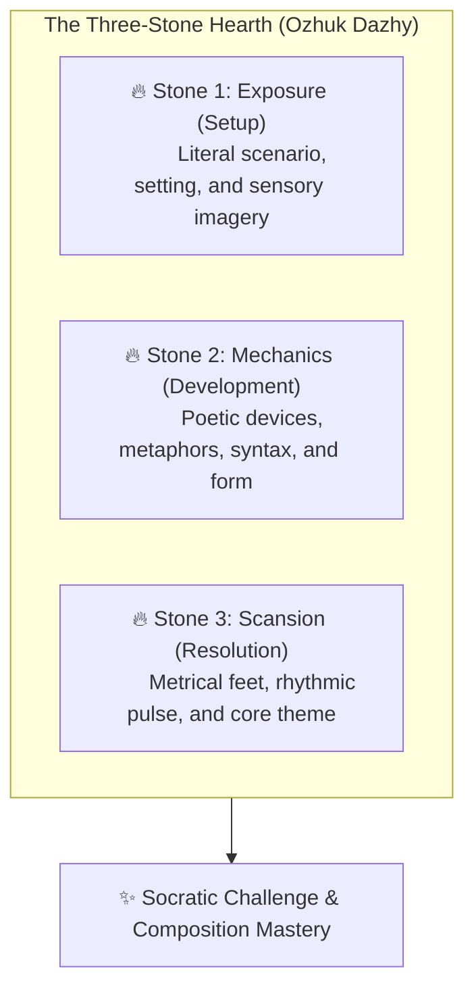
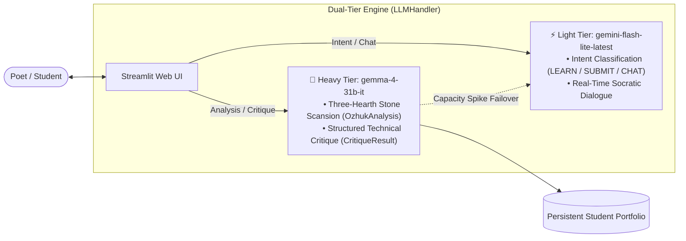

# Ожук (Ozhuk Poetry)

[](https://www.python.org/)
[](https://github.com/astral-sh/uv)
[](https://streamlit.io/)
[](https://ai.google.dev/)
[](LICENSE)

**Ozhuk Poetry** is an open-source poetry tutor and classical scansion engine built around the ancient Tuvan **Three-Stone Hearth (*Ozhuk Dazhy*)** triad. Powered by Google's **Gemma 4** (`gemma-4-31b-it`) and **Gemini Flash-Lite** via the unified Google GenAI SDK, Ozhuk teaches poets of all levels how to master metrical scansion, formal structures, and sensory imagery through an interactive Socratic curriculum and rigorous technical critique.

---

## 🏛️ The Three-Stone Hearth (*Ozhuk Dazhy*)

In traditional yurt culture, the *Ozhuk Dazhy* is the three-stone hearth that anchors the living space and sustains the fire. Ozhuk adapts this triad into a three-part analytical framework for classical and modern poetry:



1. **Stone 1: Exposure / Setup** — The foundation: sensory imagery, setting, perspective, and literal scenario (*"showing, not telling"*).
2. **Stone 2: Mechanics / Development** — The architect's tools: figurative devices, rhyme schemes, enjambment, caesura, and structural turns (*volta*).
3. **Stone 3: Scansion / Resolution** — The breath of the poem: metrical scansion (iambic, trochaic, anapestic, dactylic), rhythmic cadence, and thematic synthesis.

---

## ⚡ Architecture & Dual-Tier Model Engine

Ozhuk utilizes a pure **Gemini API** integration with intelligent dual-tier model routing and resilient cloud failover:



- **Primary / Heavy Tier (`gemma-4-31b-it`)**: High-parameter open model accessed via Gemini API for deep literary analysis, metrical scansion, and structured JSON generation.
- **Conversational / Light Tier (`gemini-flash-lite-latest`)**: Sub-second latency model for conversational flow, greetings, and routing prompts between instruction and review.
- **Resilient Cloud Failover & Retries**: Built-in automated retries for transient server errors (`500 INTERNAL` / `503 UNAVAILABLE`) with graceful cloud failover to ensure uninterrupted learning sessions.
- **Deterministic Structured Output**: Structured Pydantic schemas ([`CritiqueResult`](file:///E:/Programming/Ozhuk/ozhuk-poetry/src/ozhuk_poetry/critic.py), [`OzhukAnalysis`](file:///E:/Programming/Ozhuk/ozhuk-poetry/src/ozhuk_poetry/ozhuk_engine.py)) eliminate false positives in milestone advancement.

---

## 🎮 Modes of Operation

### 1. 🎓 Curriculum Mode (The Ozhuk Path)
A 3-stage structured journey that takes the student from basic meter to original composition:
- **Stage 1: The Foundations**:
  - `s1_m1`: Rhythm & Rhyme
  - `s1_m2`: Sensory Imagery (Stone 1)
  - `s1_m3`: Basic Poetic Flow
- **Stage 2: The Architect's Tools**:
  - `s2_m1`: Formal Structures (Sonnets, Haikus, Villanelles)
  - `s2_m2`: Literary Devices (Stone 2)
  - `s2_m3`: Structural Cohesion
- **Stage 3: The Master's Breath**:
  - `s3_m1`: Complex Scansion (Stone 3)
  - `s3_m2`: Synthesis & Theme
  - `s3_m3`: Original Composition Mastery

> **Portfolio Persistence**: Approved poems (`CritiqueVerdict.PASS`) are permanently saved to your personal portfolio, visible in the sidebar across sessions.

### 2. 🖋️ Critic's Study (Stateless Mode)
A high-precision, stateless critique studio. Paste any poem to receive an immediate technical dissection covering strengths, applied concepts, concrete suggestions, and formal scansion metrics.

---

## 🚀 Quickstart

### Prerequisites
- Python 3.12 or newer
- [uv](https://docs.astral.sh/uv/) (recommended) or standard `pip`
- A Google Gemini API key ([Google AI Studio](https://aistudio.google.com/))

### 1. Clone the Repository
```bash
git clone https://github.com/codename-warhammer09/ozhuk-poetry.git
cd ozhuk-poetry
```

### 2. Configure Environment Variables
Copy `.env.example` to `.env` and insert your Gemini API key:
```bash
cp .env.example .env
```

Edit `.env`:
```env
GEMINI_API_KEY=your_gemini_api_key_here
GEMINI_PRIMARY_MODEL=gemma-4-31b-it
GEMINI_LIGHT_MODEL=gemini-flash-lite-latest
```

### 3. Install Dependencies
Using `uv`:
```bash
uv sync
```
Or using `pip`:
```bash
pip install -r requirements.txt
```

### 4. Launch the Web Application
Using the installed console command:
```bash
uv run ozhuk-poetry
```
Or directly through Streamlit:
```bash
uv run streamlit run src/ozhuk_poetry/app.py
```

---

## 🧪 Testing & Verification

Ozhuk includes automated test scripts verifying curriculum persistence and live Gemini API generation:

```bash
# Verify curriculum stage advancement and portfolio persistence
uv run python test_tutor.py

# Verify live Gemini API models, structured Pydantic output, and Three-Stone scansion
uv run python test_llm.py

# Diagnostic script to list all models available to your API key
uv run python list_models.py
```

---

## 📂 Project Structure

```
ozhuk-poetry/
├── src/
│   └── ozhuk_poetry/
│       ├── __init__.py       # Package init & CLI launcher (ozhuk-poetry command)
│       ├── app.py            # Streamlit web application & dual-mode UI
│       ├── critic.py         # PoetryCritic & Pydantic CritiqueResult schema
│       ├── llm_handler.py    # Resilient Gemini API client (Gemma 4 & Flash-Lite)
│       ├── ozhuk_engine.py   # Three-Stone Hearth analysis engine & PoetryDB fetch
│       └── tutor.py          # PoetryTutor, Curriculum stages & Portfolio persistence
├── .env.example              # Environment variables template
├── .gitignore                # Git ignore configuration
├── LICENSE                   # MIT License
├── list_models.py            # Utility script to inspect available Gemini models
├── pyproject.toml            # Project packaging & dependency specifications
├── README.md                 # Project documentation
├── requirements.txt          # Pinned dependency requirements
├── test_llm.py               # Live integration test suite for LLM tiers
├── test_tutor.py             # Unit tests for curriculum & profile progression
└── uv.lock                   # Deterministic lockfile
```

---

## 📄 License

This project is licensed under the [MIT License](LICENSE).
